# Sistema Experto de Apoyo a la Orientación Académica

Aplicación **web** en **Python 3.10+** con **Flask** y **PostgreSQL** (local, en Docker o en la nube con **Neon**).
A partir de las respuestas de un aspirante a un cuestionario de 11 preguntas, identifica las **cinco hipótesis**
(programas académicos) de mayor probabilidad de afinidad mediante **consultas granulares sucesivas** a una base de
conocimiento, sin sentencias condicionales sobre el dominio en el código.

> El resultado es un **grado de afinidad**, no una decisión ni una recomendación de admisión.

El documento técnico completo (formulación, manual técnico, reglas, diagramas y aplicación web) está en
[`docs/sistema_experto_academico-2.pdf`](docs/sistema_experto_academico-2.pdf).

## Contenido

1. [Qué hace](#qué-hace)
2. [Base de conocimiento](#base-de-conocimiento)
3. [Cómo infiere](#cómo-infiere)
4. [Diagramas](#diagramas)
5. [Capturas de la aplicación](#capturas-de-la-aplicación)
6. [Estructura del proyecto (MVC)](#estructura-del-proyecto-mvc)
7. [Instalación y ejecución](#instalación-y-ejecución)
8. [Funcionalidad por rol y rutas](#funcionalidad-por-rol-y-rutas)
9. [Seguridad](#seguridad)
10. [Pruebas](#pruebas)
11. [Versión anterior](#versión-anterior)

## Qué hace

El aspirante responde tres bloques de preguntas:

| Bloque | Preguntas | Respuesta | Clasificación |
|---|---|---|---|
| Desempeño académico | 4 áreas: Lógico-Matemática, Científico-Investigativa, Social-Humanística, Administrativo-Financiera | Promedio de 1,0 a 5,0 | Alto (4,0–5,0), Medio (3,5–3,9), Bajo (1,0–3,4) |
| Intereses vocacionales (test RIASEC) | 6 categorías: Realista, Investigativo, Artístico, Social, Emprendedor, Convencional | Porcentaje de 0 a 100 | Alto (≥ 70 %), Medio (40–69 %), Bajo (< 40 %) |
| Estilo de trabajo | 1 pregunta | Independiente o Equipo | — |

Con esas respuestas el sistema deriva los hechos del perfil, consulta los gránulos de conocimiento de cada hecho,
contabiliza las coincidencias por programa, calcula la probabilidad de cada uno y presenta los cinco primeros, con la
explicación de las reglas que los respaldan y el recorrido por el árbol de decisión.

## Base de conocimiento

Todo el conocimiento está guardado como **datos** en PostgreSQL (esquema `conocimiento`), no en el código. Se puede
modificar sin cambiar el programa.

| Elemento | Cantidad | Tabla | Descripción |
|---|---|---|---|
| Hipótesis | 24 | `hipotesis_programas` | Programas académicos H01 a H24 |
| Variables | 11 | `variables_perfil` | 4 áreas, 6 categorías RIASEC y estilo de trabajo |
| Preguntas | 11 | `preguntas_cuestionario_vocacional` | Enunciado y dominio válido de cada respuesta |
| Hechos (reglas RC) | 32 | `hechos_perfil` | Variable + valor (Alto, Medio, Bajo, Independiente, Equipo) con su rango de clasificación |
| Gránulos (reglas RG) | 72 | `granulos_hecho_hipotesis` | Hecho → hipótesis con un peso: área Alta 0,40, interés Alto 0,40, estilo 0,20 |
| Reglas RN | 3 | `reglas_resultado_no_concluyente` | Condiciones que marcan el resultado como no concluyente |

Cada programa tiene tres gránulos: un área en nivel **Alto**, un interés RIASEC en nivel **Alto** y un estilo de
trabajo. Los niveles Medio y Bajo se clasifican y se guardan, pero no suman afinidad (sí cuentan para las reglas RN).

Reglas de resultado no concluyente:

- **RN-01** Bajo rendimiento general: las cuatro áreas con desempeño Bajo.
- **RN-02** Empate entre áreas: dos o más áreas con desempeño Alto.
- **RN-03** Empate de interés: dos o más categorías RIASEC con interés Alto.

Las transacciones de cada evaluación se guardan en el esquema `transaccional` (aspirantes, evaluaciones, respuestas,
tabla de contabilización, cinco hipótesis y marcas de resultado no concluyente).

Scripts SQL en [`bd/`](bd):

| Script | Contenido |
|---|---|
| `01_esquema.sql` | Esquemas, tablas, claves, restricciones y triggers |
| `02_carga_conocimiento.sql` | Carga del conocimiento y cuentas de prueba |
| `03_consultas_granulos.sql` | Consultas de gránulos por hipótesis |

## Cómo infiere

El motor (`app/modelo/motor_inferencia.py`) no contiene condicionales sobre programas, áreas, categorías ni valores.

1. **RF-02. Derivación de hechos.** Por cada una de las 11 respuestas, una consulta devuelve el hecho cuyo rango
   contiene el valor (reglas RC).
2. **RF-03. Consulta granular.** Por cada hecho, una consulta independiente a `granulos_hecho_hipotesis`. Cada gránulo
   suma 1 coincidencia y su peso a la hipótesis correspondiente en la tabla de contabilización.
3. **RF-03. Probabilidad.** P(h) = suma de pesos de h ÷ suma de pesos de todas las hipótesis contabilizadas × 100.
   Se ordena por probabilidad, luego por número de coincidencias y luego por código, y se toman las cinco primeras.
4. **Reglas RN.** Se cuentan los hechos por (tipo de variable, valor) y se comparan con el operador y la cantidad que
   indica cada regla en la base de conocimiento.
5. **RNF-04. Persistencia.** La evaluación completa se guarda en una sola transacción. Los triggers de la base impiden
   modificarla o eliminarla después.

Ejemplo (el mismo del documento técnico): promedios 4,5 / 3,7 / 3,4 / 3,9; RIASEC 60, 80, 30, 55, 35 y 45 %;
estilo Independiente. Resultado: Ingeniería de Software 15,63 %, Ingeniería de Sistemas 12,50 %, Ingeniería
Mecánica 9,38 %, Estadística 9,38 % y Biología 9,38 %.

## Diagramas

Los diagramas en SVG se generan con [`docs/diagramas/generar_diagramas.py`](docs/diagramas/generar_diagramas.py)
(también se exportan a PDF en `docs/*.svg.pdf`). Los diagramas hechos en draw.io están en PDF en `docs/` y aquí se
muestran en PNG.

### Árbol de decisión

Cada nivel es un hecho con su peso (área Alta 0,40 → interés Alto 0,40 → estilo 0,20) y cada hoja es una hipótesis.
La rama roja agrupa las condiciones de resultado no concluyente.
PDF: [`docs/Arbol_de_Decision_corregido.drawio.pdf`](docs/Arbol_de_Decision_corregido.drawio.pdf)

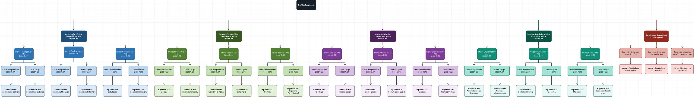

### Modelo relacional (bases de conocimiento y transaccional)

PDF: [`docs/Modelo_Relacional_Corregido.drawio.pdf`](docs/Modelo_Relacional_Corregido.drawio.pdf)

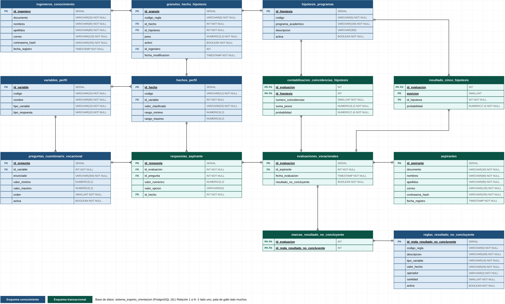

### Casos de uso de alto nivel

Roles: aspirante e ingeniero del conocimiento.
PDF: [`docs/CasosDeUso.svg.pdf`](docs/CasosDeUso.svg.pdf)

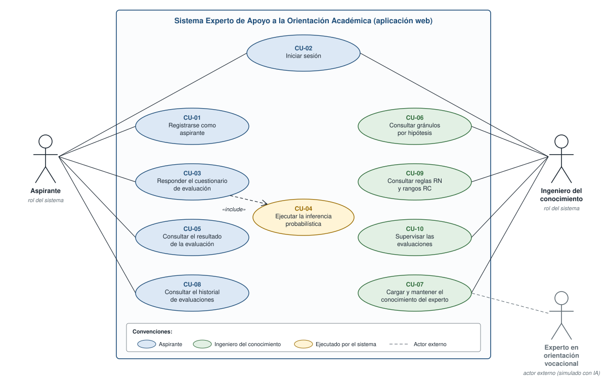

### Caja negra del sistema experto

PDF: [`docs/CajaNegra.drawio.pdf`](docs/CajaNegra.drawio.pdf)

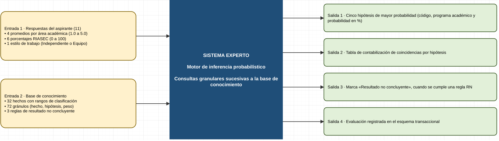

### Diagrama de flujo de datos

Nivel 0 (contexto). PDF: [`docs/DFD_Nivel0.drawio.pdf`](docs/DFD_Nivel0.drawio.pdf)

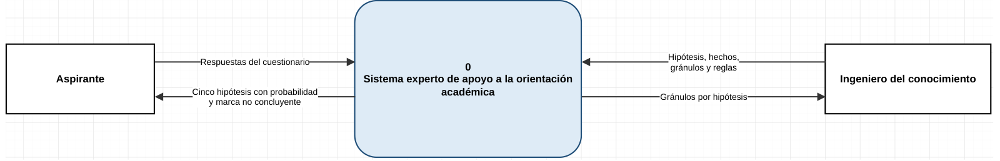

Nivel 1 del sistema de inferencia: los procesos 2.0 a 6.0 forman el motor de inferencia.

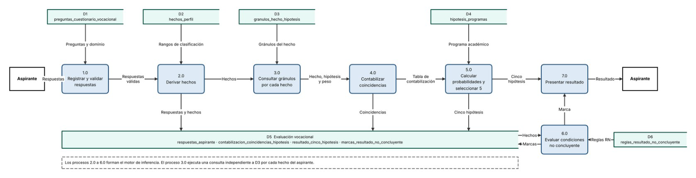

### Diagrama de clases DAO

`BaseDAO` y un DAO por tabla, la fábrica de conexiones, la fachada `SistemaExperto` y el `MotorInferencia`.
PDF: [`docs/Clases_DAO.svg.pdf`](docs/Clases_DAO.svg.pdf) · Detalle en Mermaid:
[`docs/diagrama_clases_dao.md`](docs/diagrama_clases_dao.md)

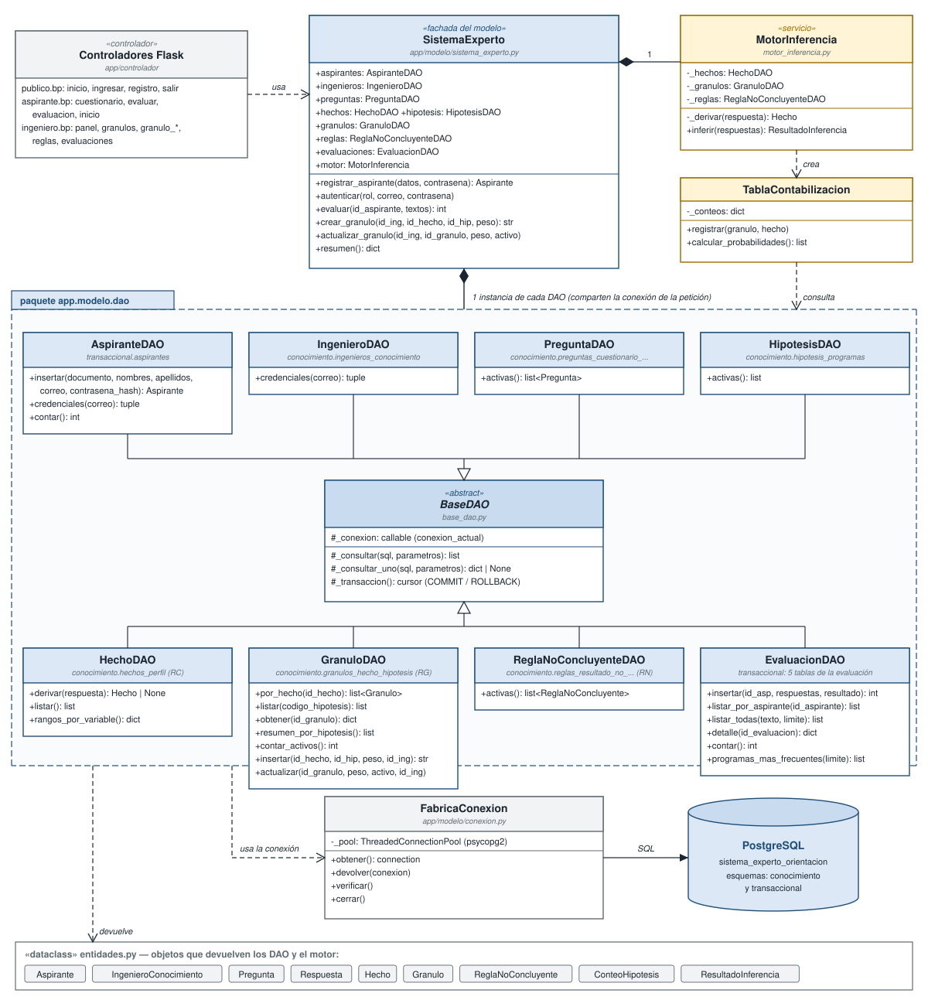

### Arquitectura de la aplicación web (MVC)

PDF: [`docs/Arquitectura_Web_MVC.svg.pdf`](docs/Arquitectura_Web_MVC.svg.pdf)

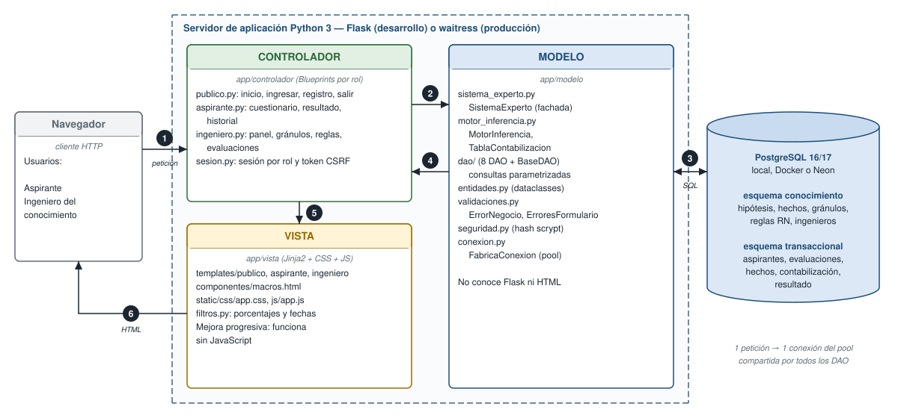

## Capturas de la aplicación

**Cuestionario por bloques.** Cada bloque explica qué mide, qué se escribe y cómo se clasifica cada valor; no deja
avanzar con respuestas vacías o fuera de rango y termina con una revisión de todas las respuestas.

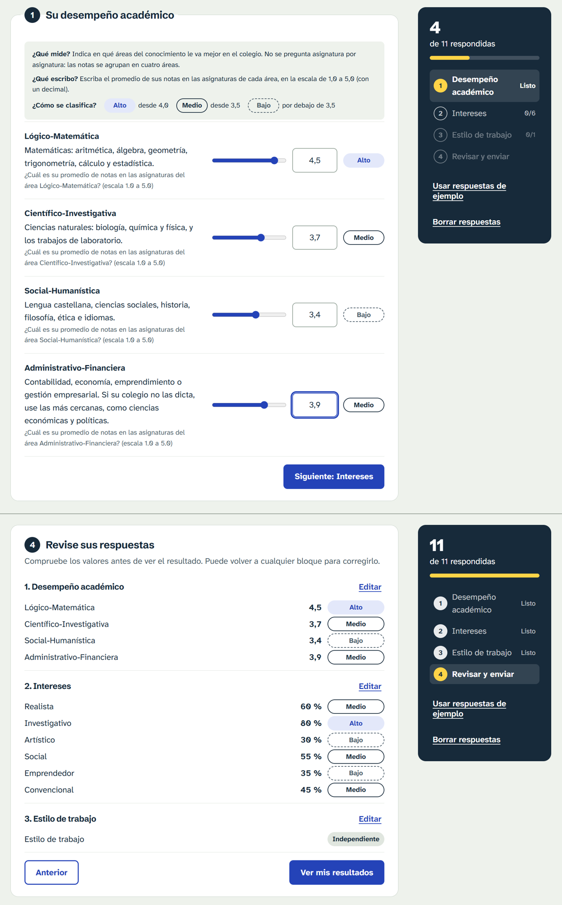

**Resultado.** Programa con mayor afinidad, cinco hipótesis, respuestas clasificadas, explicación por reglas y tabla
de contabilización.

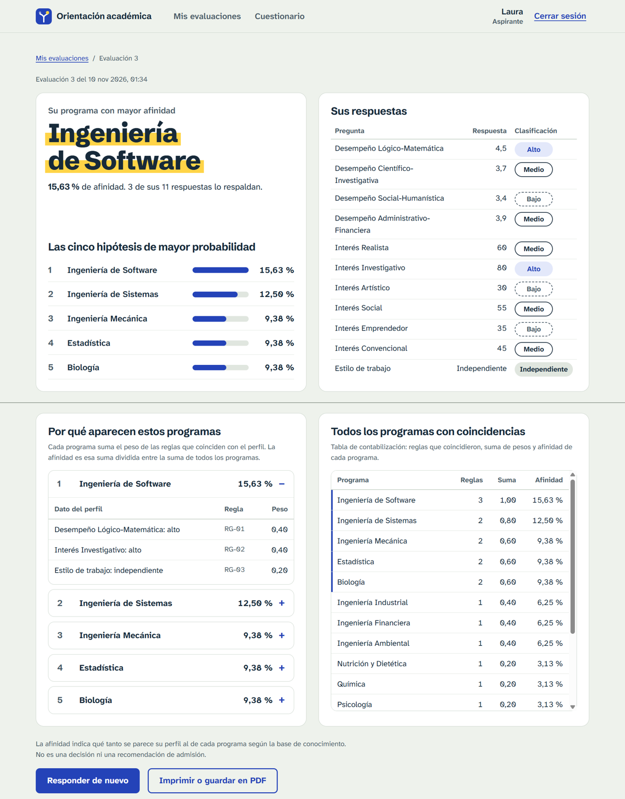

**Recorrido por el árbol de decisión.** Muestra el árbol completo y se anima nivel por nivel. En azul, los hechos
del aspirante que coinciden con cada rama; en gris, los que no. Cada hoja muestra la afinidad que obtuvo el programa.

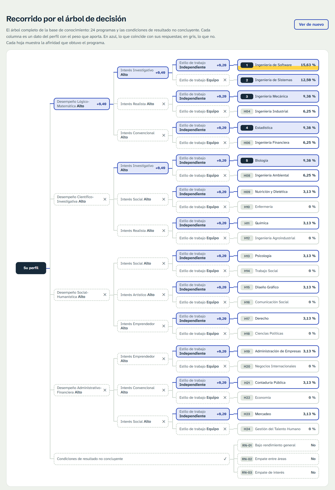

Diseño de la interfaz (colores, tipografía y decisiones de uso): [`docs/diseno_interfaz.md`](docs/diseno_interfaz.md).

## Estructura del proyecto (MVC)

```
run.py                          Punto de entrada: crea la app y arranca el servidor
app/
  __init__.py                   crear_app(): instancia el modelo y registra la vista y los controladores
  config.py                     Lee .env: base de datos, clave de sesión, puerto
  modelo/                       M: datos y lógica de negocio (no conoce Flask ni HTML)
    sistema_experto.py          Fachada del modelo: registrar, autenticar, evaluar, mantener gránulos
    entidades.py                Aspirante, Pregunta, Respuesta, Hecho, Granulo, ConteoHipotesis, ...
    motor_inferencia.py         MotorInferencia y TablaContabilizacion
    arbol_decision.py           Arma el recorrido del árbol de decisión que se muestra en el resultado
    validaciones.py             Validación de respuestas, registro y pesos; errores de negocio
    seguridad.py                Hash de contraseñas (scrypt)
    conexion.py                 Pool de conexiones PostgreSQL (FabricaConexion)
    dao/                        BaseDAO y un DAO por tabla: Aspirante, Ingeniero, Pregunta, Hecho, Hipotesis,
                                Granulo, ReglaNoConcluyente, Evaluacion
  vista/                        V: presentación
    templates/                  Plantillas Jinja (publico/, aspirante/, ingeniero/, componentes/)
    static/                     CSS, JavaScript e imágenes
    filtros.py                  Formato de porcentajes, números y fechas
  controlador/                  C: rutas Flask (Blueprints) por rol
    publico.py                  Inicio, registro, ingreso y salida
    aspirante.py                Cuestionario, resultado e historial
    ingeniero.py                Panel, gránulos, reglas y evaluaciones
    sesion.py                   Sesión por rol y protección CSRF
bd/                             Scripts SQL: esquema, carga del conocimiento, consultas de gránulos
docs/                           Documento técnico, diagramas (PDF, SVG y PNG) y capturas
pruebas/                        Pruebas del motor, del árbol de decisión y de la capa web (sin base de datos)
legado/aws_lambda/              Versión anterior: API en AWS Lambda + base de conocimiento en S3
```

Flujo de una petición: **navegador → controlador → modelo (SistemaExperto → DAO / motor → PostgreSQL) →
controlador → vista (plantilla) → navegador**.

## Instalación y ejecución

Requisitos: Python 3.10 o superior y un servidor PostgreSQL (Docker, instalado en el equipo o Neon).

### 1. Preparar la base de datos

**Opción A: Docker (recomendada).**

```
docker compose up -d
```

Crea PostgreSQL 17 en el puerto **5439** (usuario `admin`, contraseña `admin123`, base
`sistema_experto_orientacion`). La primera vez, cuando el volumen está vacío, carga automáticamente los tres scripts
de `bd/`.

**Opción B: PostgreSQL local o Neon.** Ejecute en orden `bd/01_esquema.sql`, `bd/02_carga_conocimiento.sql` y
`bd/03_consultas_granulos.sql` (pgAdmin › Query Tool, o Neon › SQL Editor).

### 2. Configurar el archivo `.env`

Copie `.env.example` como `.env` (en la misma carpeta de `run.py`) y complete los datos:

- `SEO_BD_PERFIL`: servidor a usar, `local` o `neon`.
- `LOCAL_BD_*` o `NEON_BD_*`: datos de conexión. Si usa Docker, ponga `LOCAL_BD_PUERTO=5439`,
  `LOCAL_BD_USUARIO=admin` y `LOCAL_BD_CLAVE=admin123`.
- `SEO_CLAVE_SECRETA`: clave para firmar las sesiones; así sobreviven a un reinicio del servidor. Genere una con:

```
python -c "import secrets; print(secrets.token_hex(32))"
```

El archivo `.env` no se sube al repositorio (está en `.gitignore`).

### 3. Instalar dependencias y ejecutar

```
python -m pip install -r requirements.txt
python run.py                  # desarrollo: http://127.0.0.1:5000
python run.py --produccion     # servidor waitress en 0.0.0.0:5000
```

Dependencias: Flask, psycopg2-binary y waitress.

### Cuentas de prueba

Las carga `02_carga_conocimiento.sql` (cámbielas en un entorno real):

| Rol | Correo | Contraseña |
|---|---|---|
| Ingeniero del conocimiento | ingeniero.conocimiento@umb.edu.co | Ingeniero2026* |
| Aspirante | laura.martinez@correo.com | Aspirante2026* |

También puede crear una cuenta de aspirante desde la página de inicio.

## Funcionalidad por rol y rutas

**Aspirante:** crear una cuenta, iniciar sesión, responder el cuestionario por bloques (con la descripción de cada
pregunta y la clasificación en vivo según los rangos de la base de conocimiento), ver el resultado con las cinco
hipótesis, la explicación por reglas, la tabla de contabilización y el recorrido animado por el árbol de decisión,
consultar su historial de evaluaciones e imprimir o guardar el resultado en PDF.

**Ingeniero del conocimiento:** ver un panel con indicadores, consultar los gránulos por hipótesis, agregar gránulos,
editar su peso, activarlos o desactivarlos, revisar las reglas RN y los rangos RC, y buscar y revisar todas las
evaluaciones.

| Rol | Caso de uso | Requerimiento | Ruta (método HTTP) |
|---|---|---|---|
| Público | CU-01 Registrarse como aspirante | RF-01 | `POST /registro` |
| Aspirante e ingeniero | CU-02 Iniciar sesión (y cerrarla) | RF-01 | `POST /ingresar`, `POST /salir` |
| Aspirante | CU-03 y CU-04 Responder el cuestionario y ejecutar la inferencia | RF-02, RF-03 | `GET` y `POST /aspirante/cuestionario` |
| Aspirante | CU-05 Consultar el resultado de la evaluación | RF-03 | `GET /aspirante/evaluaciones/<id>` |
| Aspirante | CU-08 Consultar el historial de evaluaciones | RF-02 | `GET /aspirante/` |
| Ingeniero | Panel con indicadores de la base de conocimiento | RF-04 | `GET /ingeniero/` |
| Ingeniero | CU-06 Consultar gránulos por hipótesis | RF-04 | `GET /ingeniero/granulos?hipotesis=H01` |
| Ingeniero | CU-07 Cargar y mantener el conocimiento | RF-04 | `GET` y `POST /ingeniero/granulos/nuevo`, `GET` y `POST /ingeniero/granulos/<id>` |
| Ingeniero | CU-09 Consultar reglas RN y rangos RC | RF-04 | `GET /ingeniero/reglas` |
| Ingeniero | CU-10 Supervisar las evaluaciones | RF-04 | `GET /ingeniero/evaluaciones`, `GET /ingeniero/evaluaciones/<id>` |

La interfaz funciona también sin JavaScript: el cuestionario muestra los tres bloques juntos y el árbol se anima solo
con CSS.

## Seguridad

- Contraseñas guardadas con hash scrypt.
- Rutas protegidas por rol; cada aspirante solo puede ver sus propias evaluaciones.
- Todos los formularios llevan token CSRF.
- Cookie de sesión HttpOnly y SameSite=Lax.
- Consultas con parámetros, sin concatenar valores en el SQL.
- Las evaluaciones no se pueden modificar ni eliminar después de registradas (triggers en la base).

## Pruebas

```
python -m unittest discover -s pruebas -v
```

18 pruebas, sin base de datos: motor de inferencia (`test_motor_inferencia.py`), recorrido del árbol de decisión
(`test_arbol_decision.py`) y capa web (`test_web.py`).

## Versión anterior

[`legado/aws_lambda/`](legado) conserva la primera versión web: una API FastAPI en AWS Lambda que lee la base de
conocimiento desde un JSON en S3, más una página estática. No tenía usuarios ni procesos transaccionales, por eso la
reemplazó la aplicación Flask. Detalles en [`legado/README.md`](legado/README.md).
