# Diagrama de clases DAO

Arquitectura MVC de la aplicación web:

```
Navegador ──HTTP──> CONTROLADOR (controlador/: Blueprints Flask por rol)
                         │  llama a                      ▲ elige plantilla
                         ▼                               │
                    MODELO (modelo/)                VISTA (vista/: Jinja + CSS + JS)
                    SistemaExperto ── MotorInferencia
                         │
                         ▼
                    DAO ── FabricaConexion (pool) ── PostgreSQL (conocimiento + transaccional)
```

GitHub, VS Code y la mayoría de editores Markdown muestran el diagrama Mermaid de abajo. También se puede pegar en

```mermaid
classDiagram
    direction TB

    class FabricaConexion {
        -configuracion: dict
        -pool: ThreadedConnectionPool
        +obtener() connection
        +devolver(conexion)
        +verificar()
        +cerrar()
    }

    class BaseDAO {
        <<abstract>>
        #proveedor_conexion: callable
        #_consultar(sql, parametros) list
        #_consultar_uno(sql, parametros) dict
        #_transaccion() cursor
    }

    class AspiranteDAO {
        +insertar(documento, nombres, apellidos, correo, contrasena_hash) Aspirante
        +credenciales(correo) tuple
        +contar() int
    }
    class IngenieroDAO {
        +credenciales(correo) tuple
    }
    class PreguntaDAO {
        +activas() list~Pregunta~
    }
    class HechoDAO {
        +derivar(respuestas) tuple
        +listar() list
        +rangos_por_variable() dict
    }
    class HipotesisDAO {
        +activas() list
        +por_codigo(codigo) dict
    }
    class GranuloDAO {
        +por_hecho(id_hecho) list~Granulo~
        +maximos_por_hipotesis() dict
        +listar(codigo_hipotesis) list
        +obtener(id_granulo) dict
        +resumen_por_hipotesis() list
        +contar_activos() int
        +insertar(id_hecho, id_hipotesis, peso, id_ingeniero) str
        +actualizar(id_granulo, peso, activo, id_ingeniero) bool
    }
    class ReglaNoConcluyenteDAO {
        +activas() list~ReglaNoConcluyente~
    }
    class EvaluacionDAO {
        +insertar(id_aspirante, respuestas, resultado) int
        +listar_por_aspirante(id_aspirante) list
        +listar_todas(texto, limite) list
        +detalle(id_evaluacion) dict
        +contar() int
        +programas_mas_frecuentes(limite) list
    }

    BaseDAO <|-- AspiranteDAO
    BaseDAO <|-- IngenieroDAO
    BaseDAO <|-- PreguntaDAO
    BaseDAO <|-- HechoDAO
    BaseDAO <|-- HipotesisDAO
    BaseDAO <|-- GranuloDAO
    BaseDAO <|-- ReglaNoConcluyenteDAO
    BaseDAO <|-- EvaluacionDAO
    BaseDAO ..> FabricaConexion : usa la conexión de la petición

    class MotorInferencia {
        +inferir(respuestas) ResultadoInferencia
    }
    class TablaContabilizacion {
        +registrar(granulo, hecho)
        +calcular() list~ConteoHipotesis~
    }
    MotorInferencia --> HechoDAO
    MotorInferencia --> GranuloDAO
    MotorInferencia --> ReglaNoConcluyenteDAO
    MotorInferencia ..> TablaContabilizacion : crea

    class SistemaExperto {
        <<fachada del modelo>>
        +aspirantes, ingenieros, preguntas, hechos
        +hipotesis, granulos, reglas, evaluaciones: DAO
        +motor: MotorInferencia
        +registrar_aspirante(datos, contrasena) Aspirante
        +autenticar(rol, correo, contrasena)
        +evaluar(id_aspirante, textos) int
        +crear_granulo(id_ingeniero, id_hecho, id_hipotesis, peso) str
        +actualizar_granulo(id_ingeniero, id_granulo, peso, activo)
        +resumen() dict
    }
    SistemaExperto *-- AspiranteDAO
    SistemaExperto *-- IngenieroDAO
    SistemaExperto *-- PreguntaDAO
    SistemaExperto *-- HechoDAO
    SistemaExperto *-- HipotesisDAO
    SistemaExperto *-- GranuloDAO
    SistemaExperto *-- ReglaNoConcluyenteDAO
    SistemaExperto *-- EvaluacionDAO
    SistemaExperto *-- MotorInferencia
```

<https://mermaid.live> para exportarlo como imagen.



## Correspondencia DAO ↔ tablas

| DAO | Tablas |
|---|---|
| AspiranteDAO | transaccional.aspirantes |
| IngenieroDAO | conocimiento.ingenieros_conocimiento |
| PreguntaDAO | conocimiento.preguntas_cuestionario_vocacional, conocimiento.variables_perfil |
| HechoDAO | conocimiento.hechos_perfil (reglas RC) |
| HipotesisDAO | conocimiento.hipotesis_programas |
| GranuloDAO | conocimiento.granulos_hecho_hipotesis (reglas RG) |
| ReglaNoConcluyenteDAO | conocimiento.reglas_resultado_no_concluyente (reglas RN) |
| EvaluacionDAO | transaccional.evaluaciones_vocacionales, respuestas_aspirante, contabilizacion_coincidencias_hipotesis, resultado_cinco_hipotesis, marcas_resultado_no_concluyente |

## Roles y casos de uso implementados en la web

| Rol | Caso de uso | Ruta |
|---|---|---|
| Aspirante | CU-01 Registrarse | `POST /registro` |
| Aspirante e ingeniero | CU-02 Iniciar y cerrar sesión | `POST /ingresar`, `POST /salir` |
| Aspirante | CU-03 Responder el cuestionario | `GET/POST /aspirante/cuestionario` |
| Aspirante | CU-04 Ver el resultado (cinco hipótesis, explicación, contabilización) | `GET /aspirante/evaluaciones/<id>` |
| Aspirante | CU-05 Consultar sus evaluaciones | `GET /aspirante/` |
| Ingeniero del conocimiento | CU-06 Consultar gránulos por hipótesis | `GET /ingeniero/granulos?hipotesis=H01` |
| Ingeniero del conocimiento | CU-07 Cargar y mantener el conocimiento (crear, editar peso, activar o desactivar gránulos) | `/ingeniero/granulos/nuevo`, `/ingeniero/granulos/<id>` |
| Ingeniero del conocimiento | Consultar reglas RN y rangos RC | `GET /ingeniero/reglas` |
| Ingeniero del conocimiento | CU-08 Supervisar evaluaciones | `GET /ingeniero/evaluaciones` |
